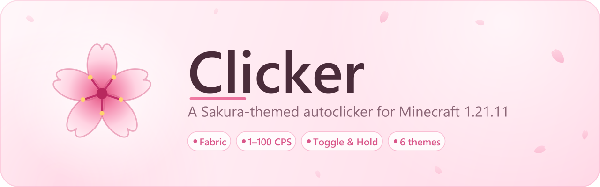
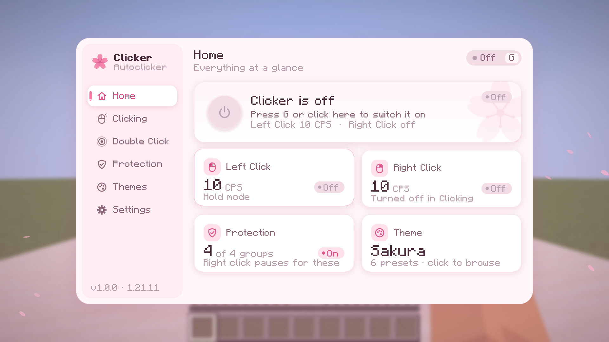
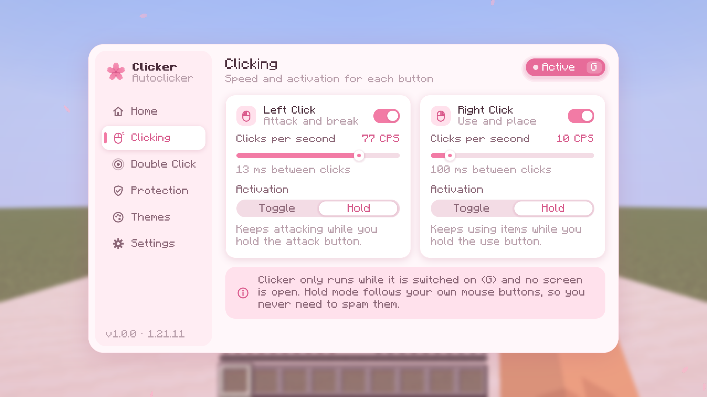
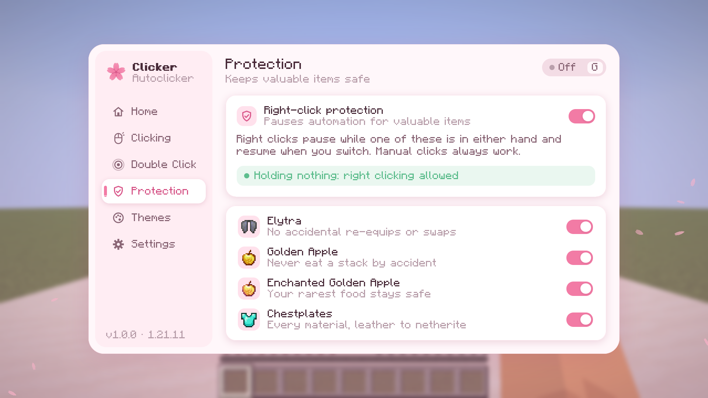
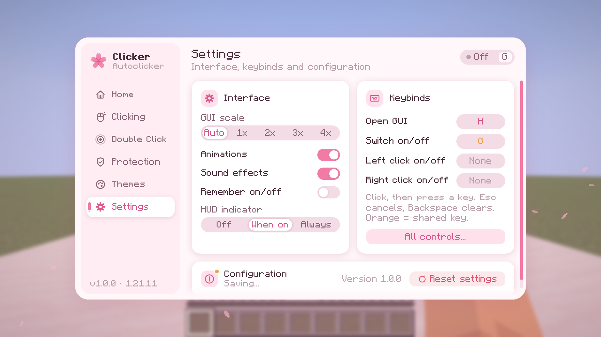
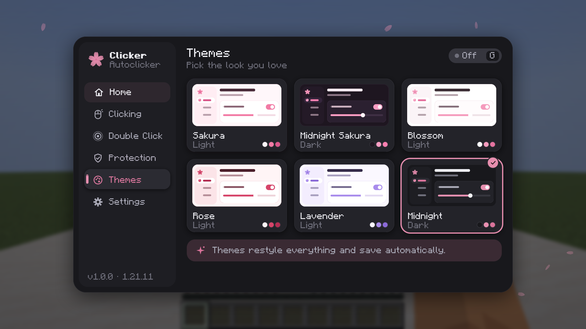
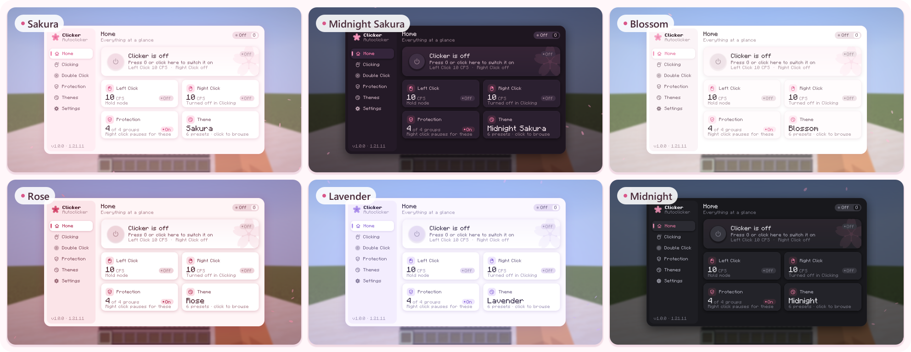
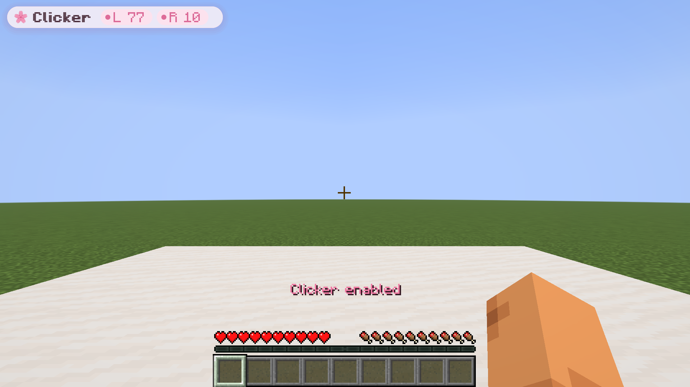

<p align="center">
  
</p>

<p align="center">
  <b>A polished, Sakura-themed autoclicker for Minecraft 1.21.11</b><br>
  Fabric · client-side only · independent left &amp; right clicking · six theme presets
</p>

<p align="center">
  
  
  
  
  <br>
  <a href="LICENSE"></a>
  <a href="https://github.com/FelixSynnn/clicker/releases/latest"></a>
  <a href="https://github.com/FelixSynnn/clicker/actions/workflows/build.yml"></a>
</p>

<p align="center">
  <a href="https://github.com/FelixSynnn/clicker/releases/latest"><b>Download</b></a> ·
  <a href="#features"><b>Features</b></a> ·
  <a href="#install"><b>Install</b></a> ·
  <a href="#keybinds"><b>Keybinds</b></a> ·
  <a href="#build-from-source"><b>Build</b></a>
</p>

<p align="center">
  
</p>

<table>
  <tr>
    <td width="50%" align="center"><br><sub><b>Clicking</b>: CPS, interval and Toggle/Hold for each button</sub></td>
    <td width="50%" align="center"><br><sub><b>Protection</b>: pause right clicks for valuable items</sub></td>
  </tr>
  <tr>
    <td width="50%" align="center"><br><sub><b>Settings</b>: GUI scale, animations, sounds, HUD and keybinds</sub></td>
    <td width="50%" align="center"><br><sub><b>Themes</b>: six presets, shown here in Midnight</sub></td>
  </tr>
</table>

<a id="features"></a>

## Features

### Clicking

- Independent **left** and **right** clicking, each **1–100 CPS** (default 10).
- **Toggle** or **Hold** activation per side. Hold mode keeps clicking while you hold the real mouse button.
- **G** switches Clicker on/off anywhere, including inside the GUI.
- Clicks are evenly spaced even above 20 CPS, and only happen in a world with no screen open.

### Double Click

- Optional **double click**: every generated click is followed by a second one.
- Delay of **1–500 ms**, set per side (default 50 ms).
- Your own manual clicks are never doubled.

### Right-Click Protection

- Pauses right-click automation while **either hand** holds an **Elytra**, **Golden Apple**, **Enchanted Golden Apple**
  or **any chestplate**.
- Works the moment you switch hotbar slots, and resumes as soon as you hold something else.
- Each item group can be switched off individually. Manual clicks are never blocked.

### GUI & Themes

- A rounded, animated GUI (**H**) with a sidebar: Home, Clicking, Double Click, Protection, Themes and Settings.
- Six theme presets that restyle every surface and control: **Sakura**, **Midnight Sakura**, **Blossom**, **Rose**,
  **Lavender** and **Midnight**.
- Mod Menu integration (optional): its *Configure* button opens the Clicker GUI.

<p align="center">
  
</p>

### HUD

- A small HUD pill shows what Clicker is doing: which sides are armed, clicking, or paused by protection.
- Pressing G also confirms the new state in the action bar.

<p align="center">
  
</p>

### Configuration

- Saved automatically to `config/clicker.json`, shortly after each change and when the GUI closes or the game stops.
- A corrupted file is kept as `clicker.json.corrupt-<time>` and replaced with defaults; a single invalid value only
  resets that value.
- Keybinds are stored by Minecraft in `options.txt`.

<a id="install"></a>

## Install

| Component | Version |
|---|---|
| Minecraft | 1.21.11 (only) |
| Fabric Loader | 0.20.1 or newer |
| Fabric API | 0.141.x+1.21.11 (built against 0.141.6) |
| Java | 21 |
| Mod Menu (optional) | 17.x for 1.21.11 |

1. Install Fabric Loader for 1.21.11 (Fabric installer, or create a 1.21.11 Fabric instance in Prism/MultiMC).
2. Put these in the instance's `mods` folder:
   - `clicker-1.0.0.jar` from the [latest release](https://github.com/FelixSynnn/clicker/releases/latest)
     (or `build/libs/` if you built it yourself)
   - Fabric API for 1.21.11 (`fabric-api-0.141.6+1.21.11.jar` or newer 0.141.x), from
     [Modrinth](https://modrinth.com/mod/fabric-api)
   - optionally Mod Menu 17.x for 1.21.11, from [Modrinth](https://modrinth.com/mod/modmenu)
3. Start the game. Press **H** in-game to open Clicker, **G** to switch it on.

Do not install the `-sources.jar`.

<a id="keybinds"></a>

## Keybinds

| Key | Action |
|---|---|
| <kbd>H</kbd> | Open / close the Clicker GUI |
| <kbd>G</kbd> | Switch Clicker on / off (also works inside the GUI) |
| unbound | Toggle left clicking / toggle right clicking |
| <kbd>1</kbd>–<kbd>6</kbd> (in the GUI) | Jump to a page |

All keys can be changed in *Options > Controls > Key Binds > Clicker*, or directly on Clicker's Settings page.

**Toggle mode** clicks continuously while Clicker is on. **Hold mode** clicks while you hold the attack (left) or
use (right) button; the first click is your own press, then Clicker continues at the chosen CPS.

Clicking only happens in a world, with no screen open (inventory, chat, pause menu, the Clicker GUI) and while you are
alive and not spectating. Leaving a world switches Clicker off unless *Remember on/off* is enabled in Settings.

<a id="build-from-source"></a>

## Build from source

Requires a JDK 21 on `PATH` (or `JAVA_HOME`). The Gradle wrapper downloads everything else.

```bash
./gradlew build
```

On Windows PowerShell/cmd use `gradlew.bat build`. The mod jar is written to `build/libs/clicker-1.0.0.jar`.

## Testing

```bash
./gradlew test                          # unit tests: click timing, double clicks, config loading
./gradlew runClientGameTest             # starts a real 1.21.11 client and verifies everything in-game
./gradlew runProductionClientGameTest   # the same in-game checks against the built jar
./gradlew runClient                     # play in a dev client (Mod Menu included)
```

`runClientGameTest` writes `build/run/clientGameTest/clicker-gametest-report.txt` and screenshots of every page and
theme to `build/run/clientGameTest/screenshots/`.

`runProductionClientGameTest` runs the same in-game checks against the finished `build/libs` jar in a production-style
client (official Minecraft jar, intermediary mappings, Fabric API and Mod Menu jars from Maven), which proves the
shipped jar's mixins and mappings work outside the dev environment. Its output goes to
`build/run/productionClientGameTest/`.

<details>
<summary><b>What the in-game tests check</b></summary>

<br>

Driven with simulated keyboard/mouse input through vanilla's own input handlers, in a survival world:

- H opens the GUI, H/Esc close it, number keys and sidebar clicks switch pages, all six themes apply and persist.
- Real mouse clicks on a toggle switch, the CPS slider (press and drag) and the Toggle/Hold selector change settings.
- G and the header pill switch Clicker on/off; nothing clicks while the GUI, inventory or pause menu is open.
- Measured click rates: 1, 10, 50 and 100 CPS in toggle mode; 20 CPS while physically holding left click; zero after
  release.
- Generated left clicks break an armor stand (two hits within 5 ticks); generated right clicks throw one snowball each.
- Double click: every click gets exactly one second click, including delays longer than the click interval.
- Protection: golden apple, enchanted golden apple, elytra and leather/copper/diamond/netherite chestplates pause right
  clicking in the main hand or offhand, switching hotbar slots resumes it instantly, nothing is eaten or equipped,
  per-group switches work, manual right clicks still work, and with protection off the chestplate does get equipped.
- Leaving the world switches Clicker off; settings reload identically from disk; a corrupted file is recovered.

</details>

<details>
<summary><b>How it works</b></summary>

<br>

- `MinecraftMixin` runs the scheduler at the start of every frame, so clicks are evenly spaced even above 20 CPS.
- Generated clicks call vanilla's own `startAttack` / `startUseItem` (via `MinecraftInvoker`), so they follow all
  vanilla rules and never feed back into the physical input state: no recursion, no duplicated presses.
- Physical input is only read through the user's attack/use key mappings.
- Second clicks of a double click are queued in a fixed-size buffer and can never schedule more clicks.

</details>

<details>
<summary><b>Project layout</b></summary>

<br>

```
src/main/java/clicker/
  Clicker.java, ClickerClient.java     constants and client entrypoint
  clicking/                            ClickerManager, ClickScheduler, DoubleClickManager, ClickStats, modes
  config/                              ClickerConfig, ConfigManager (JSON, validation, atomic saves)
  protection/                          ItemProtection, ProtectedCategory
  input/                               ClickerKeybinds, InputHandler
  mixin/                               MinecraftMixin (frame hook), MinecraftInvoker (vanilla click methods)
  gui/                                 ClickerScreen, ClickerSidebar, ClickerTheme, ThemeManager, pages/, components/
  gui/render/                          UiRenderer (rounded shapes, shadows, icons), PetalField
  gui/hud/                             ClickerHud
  compat/                              ModMenuIntegration
src/main/resources/                    fabric.mod.json, clicker.mixins.json, lang, icon and GUI textures
src/test/java/                         JUnit tests
src/gametest/java/                     in-game Fabric client gametests
tools/GenerateAssets.java              regenerates the icon/logo/petal PNGs
tools/GenerateBanner.java              regenerates the README banner and theme collage in docs/
```

</details>

## Notes and limitations

- **G is also vanilla's "Quick Actions" key** in 1.21.11. Quick Actions only does something on servers that define
  quick-action dialogs; rebind either key if that matters to you.
- Vanilla rules still apply to generated clicks: the attack cooldown and hurt-immunity still limit damage, clicking
  air in survival triggers the vanilla miss penalty, and placing/breaking blocks happens at most once per game tick
  (Minecraft only updates what you are looking at 20 times per second). Entity hits and item use (e.g. throwing
  snowballs) are sent at the full CPS.
- The GUI uses Minecraft's own font.

> [!WARNING]
> Many multiplayer servers forbid autoclickers. Clicker has no anti-cheat bypasses or stealth features; check the
> rules of any server before using it.

## License

[MIT](LICENSE) © 2026 FelixSyn
